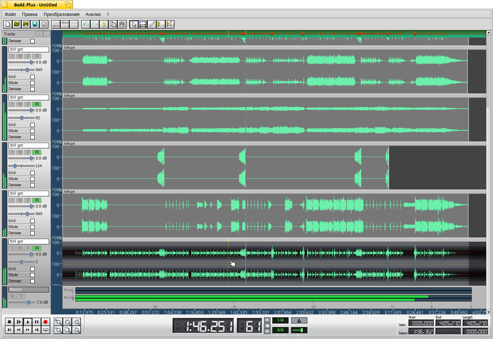

# BeAE-Plus 3.1

A multitrack audio editor for Haiku. Fork of BeAE by Frans van Nispen.



Authors: Stas Korobov (grossekatze1@gmail.com), developed together with Claude (Anthropic).
Original BeAE: Frans van Nispen. The full version history is in `BeAE/Help/history.html`.

## Features

**Multitrack editing**
- Any number of tracks with clips: move, trim, split, crossfade, snap to grid, group tracks, mute / solo.
- Per-track volume, pan and effect chain (FX), master volume and master effects, sidechain ducking.
- Undo / redo, project files (`.bemix`), mixdown to WAV and, with external encoders, to MP3, Ogg Vorbis, FLAC and Opus.

**Automation (new in 3.1)**
- Volume (red) and pan (blue) curves under every track, and a volume curve for the master.
- Click adds a point, drag moves it, right click or double click deletes it; the curves work in playback and in mixdown and are saved in the project.

**Gamepad / joystick control (new in 3.1)**
- Volume, pan, track selection, play / stop from a USB gamepad. Every action can be rebound (Preferences → Controllers → Bind); both digital D-pads and analogue sticks are supported.
- Automation write mode: move the stick during playback and the moves are recorded into the automation curves.

**Recording**
- Record from the system audio input, also over the tracks while playing them back.
- Latency compensation: automatic "Fine tune" measures the hardware latency with a click test (stable to about 0.3 ms), recordings are aligned using the media server's time stamps (within about 1.5 ms).

**Processing**
- Transform menu: fade in / out, normalize, amplifier, bass boost, compressor, delay, reverb, room effects, invert, swap channels and more, with real-time preview.
- Analysis: spectrum, oscilloscope, tempo detection, tuner.
- Insert from MIDI (built-in SoundFont synthesizer).
- Tempo, grid and metronome.

**Plug-ins**
- LADSPA host (also usable for the track and master effect chains) and a set of own plug-ins: reverbs (plate, spring, room), vocal chain, autotune, graphic and parametric EQ, compressors (LA-2A style, distressor, multiband), gate, noise reduction, chorus, flanger, guitar overdrive pedals (Tube Screamer, DS-1).

**Help and languages**
- Complete help in Russian, English, German, French, Spanish and Italian (`BeAE/Help`; the help of the interface language is opened).
- Interface languages: see below.

## Recording

The red Record button records from the system audio input. The format (sample rate, channels, sample type) is whatever the Haiku media mixer / input provides. Press Record or Stop to finish. The VU meters show the input level while recording. Preferences → Audio → *Fine tune* measures the latency of your sound hardware and puts it into *Recording latency*; the result window shows a detailed report.

## LADSPA plug-ins

Transform → LADSPA plug-ins lists the LADSPA effects found in `$LADSPA_PATH`, `~/config/lib/ladspa`, `~/config/non-packaged/lib/ladspa`, `/boot/system/lib/ladspa` and `/boot/system/non-packaged/lib/ladspa` (use "Rescan plug-ins" after installing new ones). Each plug-in gets a window with sliders for its control ports, a real-time preview and Apply. Supported audio layouts: 1 in / 1 out, 2 in / 2 out, 1 in / 2 out and 2 in / 1 out. Parameter values are remembered in `~/config/settings/BeAE/ladspa/`, and "Repeat last filter" works with plug-ins. The built-in effects stay available.

## Building and installing

On Haiku (the program is built on the Haiku version where it is going to run, or an older one: a binary built on a newer Haiku may not start on an older system):

```
cd Core-src && make            # the program: BeAE/BeAE
cd ../plugins && make          # LADSPA plug-ins; "make install" copies them to ~/config/non-packaged/lib/ladspa
cd .. && package/build_hpkg.sh # package BeAE_Plus-3.1-1-<arch>.hpkg
```

The package installs the program to `/system/apps/BeAE-Plus`, the plug-ins to `/system/lib/ladspa` and adds a shortcut to the Applications menu. Put the `.hpkg` into `~/config/packages` to install it. Optional external encoders for compressed saving: `lame`, `oggenc`, `flac`, `opusenc`.

Tests of the portable cores (encoder, MIDI, tuner, latency, mixer, envelopes, project file, gamepad bindings, plug-ins) run on Linux: `tests/<name>/run_tests.sh`.

## Languages

The interface language follows the system language of Haiku by default (Preferences → General → Language → System default) and can be chosen by hand. Complete: English, Russian. German, French, Spanish and Italian are machine-translated drafts (see the DRAFT note at the top of each file in `BeAE/Languages`); Hungarian, Dutch and Portuguese are partly in English. Missing strings fall back to English. Translations are plain text files (`KEY = "text"`): corrections and new languages are very welcome as pull requests or issues at https://github.com/grossekatzeru/BeAE-Plus
