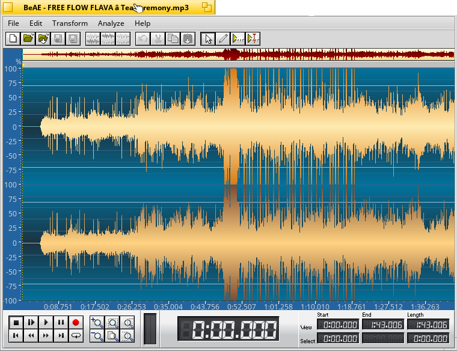

BeAE-Plus 3.1 - multitrack audio editor for Haiku (fork of BeAE by Frans van Nispen).

Authors: Stas Korobov (grossekatze1@gmail.com), developed together with Claude (Anthropic). Original BeAE: Frans van Nispen; see BeAE/Help/history.html for the full version history.

BeAE audio editor for Haiku, with a wide array of features.

Features: 
Fade-int function 
Fade-out function 
Function Normilize 
Bass bost function 
Compressor function 
Amplifier 
Delay 
Reverb 
Room Effects 
Invert opportunity 
Exchange channels possibility 

Recording: 
The red Record button records from the system audio input into a new document.
The format (sample rate, channels, sample type) is whatever the Haiku media mixer/input provides,
and the document keeps that sample rate. Press Record or Stop to finish; the recording opens as an
unsaved document. The VU meters show the input level while recording. 

LADSPA plug-ins: 
Transform &gt; LADSPA plug-ins lists the LADSPA effects found in <code>$LADSPA_PATH</code>,
<code>~/config/lib/ladspa</code>, <code>~/config/non-packaged/lib/ladspa</code>,
<code>/boot/system/lib/ladspa</code> and <code>/boot/system/non-packaged/lib/ladspa</code>
(use "Rescan plug-ins" after installing new ones). Each plug-in gets a window with sliders
for its control ports, a real-time preview and Apply. Supported audio layouts: 1 in/1 out,
2 in/2 out, 1 in/2 out and 2 in/1 out. Parameter values are remembered in
<code>~/config/settings/BeAE/ladspa/</code>, and "Repeat last filter" works with plug-ins. 
The built-in effects stay available. 

## Languages

The interface language follows the system language of Haiku by default (Preferences → General → Language → System default) and can be chosen by hand. Complete: English, Russian. German, French, Spanish and Italian are machine-translated drafts (see the DRAFT note at the top of each file in `BeAE/Languages`); Hungarian, Dutch and Portuguese are partly in English. Missing strings fall back to English. Translations are plain text files (`KEY = "text"`): corrections and new languages are very welcome as pull requests or issues at https://github.com/grossekatzeru/BeAE-Plus
